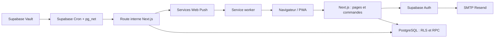

# Architecture — OnJoueQuand

**Simplification approuvée :** les nouvelles soirées passent directement à l’état confirmé via un RPC transactionnel à horaire unique. Les anciennes propositions restent compatibles. Le test Push est immédiat sur le seul appareil courant, autorisé et limité en base, sans exécuter le worker collectif. Les sept repères de l’accueil utilisent les états réels par date. Voir [ADR 020](decisions/020-soirees-simples-et-test-push.md), avec ordre des migrations avant déploiement.

Statut : J1 à J7 commités, J1–J6 poussés et CI distante réussie pour J6. Preuves PWA dans le [rapport J7](j7-validation.md). J8 prépare sauvegarde chiffrée, restauration et surveillance ; voir le [rapport J8](j8-validation.md). Installation/Push réels et exploitation distante restent à valider. Cron désactivé par défaut. Voir le [PRD](product-requirements.md), les [données](database.md), la [roadmap](roadmap.md) et les rapports historiques [J1](j1-validation.md), [J2](j2-validation.md), [J3](j3-validation.md), [J4](j4-validation.md), [J5](j5-validation.md), [J6](j6-validation.md).

## Vue d'ensemble

Monolithe modulaire Next.js App Router sur Vercel. Supabase fournit Auth et PostgreSQL ; les politiques RLS et transactions SQL restent la dernière ligne de contrôle des données. Aucun serveur métier indépendant, ORM, Redis ou système de queue externe.



Les flèches vers les fournisseurs sont des frontières d'infrastructure, pas des microservices applicatifs. Les commandes utilisateur sont exécutées avec leur session Supabase. Le provisionnement Auth et les jobs disposent de privilèges distincts, côté serveur seulement.

## Stack et versions

| Élément | Choix | Politique |
| --- | --- | --- |
| Runtime | Node.js LTS ; repère approuvé : 24 | Même ligne LTS en local, CI et Vercel ; correctif stable supporté au démarrage de J1. |
| Framework | Next.js App Router ; repère : 16.4 | Version stable corrigée et compatible avec le runtime. |
| UI | React ; repère : 19.3 | `react` et `react-dom` de même version, compatibles avec Next.js. |
| Styles | Tailwind CSS ; repère : 4.3 ; shadcn/ui | Composants intégrés au dépôt, pas de bibliothèque de design propriétaire supplémentaire. |
| Langage | TypeScript strict | Version stable compatible avec le framework et les outils de test. |
| Données | Supabase JS, `@supabase/ssr`, PostgreSQL | Version PostgreSQL du projet hébergé reproduite localement ; types générés depuis les migrations. |
| Validation | Zod | Schémas de validation aux frontières ; règles métier dans le domaine et invariants en base. |
| Temps | `@js-temporal/polyfill` | Une seule bibliothèque temporelle, derrière l'adaptateur commun. |
| Notifications | `web-push`, VAPID | Envoi dans le runtime Node.js ; API navigateur standard et service worker. |
| Vérification | Vitest, Playwright, ESLint | Versions stables compatibles ; PostgreSQL réel pour RLS et concurrence. |
| Livraison | npm, Vercel, GitHub Actions, Supabase CLI | Versions d'outils fixées ; `package-lock.json`, `npm ci` et configuration runtime versionnés en J1. |

Les repères ci-dessus proviennent du plan approuvé du 15 octobre 2026. Les versions effectivement vérifiées et verrouillées en J1, les résultats de compilation/tests et les réserves de sécurité sont consignés dans le [rapport J1](j1-validation.md). Aucune utilisation de canary, bêta ou option expérimentale n'est requise. Sources de référence : [Node.js](https://nodejs.org/en/about/previous-releases), [Next.js](https://nextjs.org/docs/app/getting-started/installation), [React](https://react.dev/versions), [Tailwind CSS](https://tailwindcss.com/docs/installation/using-postcss), [shadcn/ui](https://ui.shadcn.com/docs/installation/next), [Vitest](https://vitest.dev/guide/), [Playwright](https://playwright.dev/docs/release-notes).

L'ajout de dépendances doit résoudre un besoin concret. Pas de bibliothèque de calendrier lourd, de gestion globale d'état ou de client de requêtes supplémentaire par défaut.

<a id="structure-cible-et-frontieres"></a>

## Structure cible et frontières

Cette arborescence est une cible pour les prochains jalons ; les répertoires applicatifs ne sont pas créés en J0.

```text
src/
  app/
    (auth)/connexion/
    (prive)/
      accueil/
      dispos/
      sessions/
      groupe/
    api/internal/jobs/
    manifest.ts
  features/
    auth/
    group/
    availability/
    matching/
    games/
    sessions/
    notifications/
  components/ui/
  lib/
    supabase/
    time/
    env/
    observability/
public/
  icons/
  sw.js
  offline.html
supabase/
  migrations/
  tests/
  seed.sql
tests/
  integration/
  e2e/
docs/
  decisions/
.github/
  workflows/
```

Chaque fonctionnalité crée les sous-ensembles nécessaires :

- `domain` : modèles, règles et calculs purs, avec horloge injectée.
- `application` : cas d'usage, contrats de dépôts et orchestration des autorisations et transactions.
- `infrastructure` : implémentations Supabase, Auth, SMTP/API et Push, marquées serveur uniquement lorsque nécessaire.
- `ui` : composants et présentation ; aucun contournement des cas d'usage.

Les routes composent les fonctionnalités ; les imports transversaux passent par les contrats publics. Les composants shadcn/ui sont dans `components/ui`. `lib` ne doit pas devenir un dépôt de règles métier non classées.

Lectures initiales en Server Components ; interactions en Client Components ; mutations en Server Actions avec validation. Après mutation, invalider le layout racine via `revalidatePrivateViews`. Le retour depuis l’arrière-plan et le bouton Actualiser rafraîchissent les écrans sans saisie modifiée ; le simple focus contrôle les droits sans vider le cache. Pas de Realtime au MVP.

Les contrôles de compte et d’adhésion utilisent `React.cache` pour dédupliquer leurs appels dans un même rendu serveur, conformément au [guide Next.js](https://nextjs.org/docs/app/guides/authentication). Aucun cache partagé entre requêtes ou utilisateurs ; chaque nouvelle requête recontrôle les droits et RLS reste active. Les lectures indépendantes démarrent en parallèle. Une frontière `loading.tsx` fournit un retour de navigation pendant les lectures, sans stocker de données privées.

Les sous-routes `/groupe/jeux`, `/groupe/reglages` et `/groupe/gestion` isolent les tâches occasionnelles des quatre écrans quotidiens. Chacune appelle `requireMember` ; la gestion vérifie également le rôle administrateur avant toute lecture des invitations. Le composant PWA reste monté dans le shell pour protéger les saisies et surveiller la connexion ; seule son aide d’installation est limitée aux réglages et masquée en mode installé. Aucun changement de service worker ni de sa liste de cache.

L’[ADR 018](decisions/018-interface-chaleureuse-et-latence.md) fixe l’exécution Vercel à Dublin ; l’[ADR 019](decisions/019-cache-navigation-privee.md) ajoute le préchargement en mémoire des quatre onglets. Le layout vérifie le contexte initial ; chaque navigation réutilisant un onglet contrôle Auth et l’adhésion via une réponse non stockée. Le retour navigateur est masqué jusqu’au contrôle ; un changement de compte ou de rôle abandonne les vues en mémoire. Aucun cache serveur partagé ni stockage privé du worker. Pages et commandes conservent `getUser`/adhésion/RLS. Les lectures d’accueil utilisent Suspense ; `/dispos` utilise `loadOwnWeek`, sans catalogue ni réponses des autres. Calendrier et matching restent dans `/dispos/groupe` et `/dispos/trouver`. Voir la [mesure et recette](navigation-validation.md).

## Contrats applicatifs et flux

Les noms suivants décrivent des contrats à implémenter, pas une API disponible. Ils retournent un résultat typé ou une erreur métier traduite en français. Les dates civiles utilisent `YYYY-MM-DD`, les instants un format ISO 8601 avec décalage explicite. Le serveur vérifie l'horizon, les bornes et les relations, même après validation cliente.

| Commande | Entrée utile | Sortie et erreurs métier attendues |
| --- | --- | --- |
| `requestCode` | Adresse e-mail | Réponse générique et délai de nouvelle demande ; limitation de fréquence, fournisseur indisponible. Ne révèle pas l'existence du compte. |
| `verifyCode` | Adresse et code | Session vérifiée ; code invalide/expiré ; aucune adhésion créée sans acceptation valide. |
| `inviteMember` | Adresse, clé d'idempotence | Invitation et état d'envoi pour l'administrateur ; déjà membre, invitation active, échec réessayable. |
| `acceptInvitation` | Identifiant d'invitation, session vérifiée | Profil et adhésion ; adresse incorrecte, invitation expirée/révoquée. L'adresse d'autorité provient d'Auth. |
| `revokeInvitation` | Identifiant, révision attendue | État révoqué ; conflit ou invitation déjà acceptée. Révoquer un membre est une commande distincte. |
| `saveAvailability` | Journées affectées, état/mode/intervalles locaux, occurrences DST, révisions attendues | Journées normalisées et nouvelles révisions ; intervalle invalide, heure ambiguë, horizon dépassé, conflit. |
| `previewWeekCopy` | Semaine source/cible, mode remplir ou remplacer | Modifications proposées, anomalies et révisions source/cible ; aucune écriture. |
| `applyWeekCopy` | Semaines, choix d'application, résolutions DST, révisions de l'aperçu | Résultat atomique ; conflit si source ou cible a changé, jamais d'application partielle silencieuse. |
| `findSlots` | Période, membres, seuil, durée, jeu facultatif | Jusqu'à dix candidats avec membres et classement ; aucun résultat est un succès vide. |
| `saveProposal` / `publishProposal` | Brouillon, candidats, échéance, seuil, révision | Proposition validée ; état interdit, créneau passé, candidats invalides. |
| `replaceBallot` | Proposition, liste de créneaux, révision du bulletin | Bulletin atomique, y compris liste vide ; vote clos, créneau étranger, conflit. |
| `confirmSession` / `cancelSession` | Proposition, créneau si confirmation, révision | Nouvel état et événement d'outbox ; acteur interdit, état changé, créneau passé. |
| `setRsvp` | Session, réponse, révision attendue | RSVP ; session non confirmée/déjà commencée, conflit d'engagement ou de révision. |
| `registerPush` / `revokePush` | Abonnement de cet appareil ou son identifiant | Abonnement privé ; endpoint invalide, appareil non possédé. |
| `markNotificationRead` | Identifiant | Lecture idempotente ; notification étrangère non accessible. |

Les commandes ordinaires ne prennent pas de `actorId` faisant autorité. Le groupe est obtenu de l'adhésion active. Les listes de membres des recherches sont des filtres validés, pas des preuves d'accès. La lecture d'une ressource absente ou invisible ne doit pas révéler son existence.

Pour les créations, une révision attendue nulle signifie « aucune ligne existante » ; une contrainte d'unicité transforme une création concurrente en conflit. Les mutations multi-journées vérifient toutes les révisions avant écriture. Les mêmes gardes sont imposées aux RPC, pour empêcher le contournement par appel direct.

La seule route HTTP métier interne prévue est `POST /api/internal/jobs`. Elle exige un secret dédié distinct des clés Auth et refuse tout appel non authentifié avant accès aux données. Les commandes utilisateur restent des Server Actions ; aucune API publique versionnée n'est prévue.

## Authentification et invitations

L'authentification est confiée à Supabase Auth ; l'autorisation au groupe reste une donnée PostgreSQL vivante. Utiliser les clients SSR officiels et vérifier la session côté serveur ; ne pas faire confiance à une simple session lue depuis un cookie non validé. Sources : [clients SSR](https://supabase.com/docs/guides/auth/server-side/creating-a-client?queryGroups=framework&framework=nextjs), [OTP e-mail](https://supabase.com/docs/guides/auth/auth-email-passwordless).

1. Un administrateur actif crée une invitation valable sept jours. Une adresse est normalisée sans règles propres à Gmail ou à un fournisseur particulier.
2. Un traitement serveur idempotent provisionne un compte Auth sans mot de passe et sans marquer l'adresse confirmée. Une erreur externe ne crée aucune adhésion.
3. Une invitation française avec code est envoyée via SMTP Auth ; elle pointe vers l'application, mais son lien n'est pas une preuve d'identité. Le destinataire peut demander un nouveau code pendant la validité de l'invitation.
4. Le code expire après dix minutes. `shouldCreateUser: false` et inscriptions publiques désactivées empêchent la création ouverte de comptes. Pour un compte non confirmé, le renvoi de confirmation prend le relais sur `signup_disabled`, conformément à [ADR 010](decisions/010-premier-code-et-invitation-smtp.md). Mailpit reçoit les e-mails locaux ; SMTP Resend reste à configurer avant production.
5. Après vérification du code, une RPC d'acceptation verrouille l'invitation et vérifie `auth.uid()`, l'adresse confirmée dans Auth, l'expiration et le statut. Elle crée/active l'adhésion et le profil puis consomme l'invitation dans une seule transaction.
6. Les connexions suivantes réutilisent l'OTP ; chaque requête protégée contrôle encore l'adhésion active.

Le code OTP est vérifié exclusivement par Auth, pas stocké ni journalisé par l'application. La limitation des demandes combine les protections Supabase et un compteur serveur durable, atomique, par adresse normalisée et origine réseau ; les clés de compteur sont dérivées et non exposées. Le compteur ne réside pas dans la mémoire éphémère d'une fonction Vercel.

Le test de compatibilité J2 doit prouver le parcours compte provisionné non confirmé → OTP avec création désactivée → acceptation, avec la configuration Supabase réellement retenue. Un compte préexistant, une panne SMTP et un timeout après provisionnement doivent être récupérables sans duplication. L'API Admin Auth n'est pas transactionnelle avec PostgreSQL : la reprise utilise l'état de provisionnement et l'identifiant de compte enregistré, jamais une compensation destructive aveugle.

Bootstrap : l'exploitant crée le groupe singleton, provisionne l'adresse de l'administrateur désigné, puis crée son adhésion avec un accès serveur contrôlé. Il valide ensuite une connexion OTP réelle et retire les moyens temporaires. Aucun secret ni utilisateur réel n'est inclus dans les seeds. Les transferts de rôle et révocations verrouillent le groupe pour protéger le dernier administrateur actif.

Un compte authentifié sans invitation valide reste sans accès. Une invitation révoquée n'est pas équivalente à une révocation d'adhésion déjà acceptée. Un membre révoqué ne peut être réactivé que par une nouvelle invitation administrative explicite.

<a id="modele-temporel-et-matching"></a>

## Modèle temporel et matching

L'adaptateur temporel central convertit date locale + heure + occurrence éventuelle en instant. Il utilise Europe/Paris indépendamment du serveur ou de l'appareil. Une journée locale peut durer 23 ou 25 heures. La base garde les bornes UTC et la date locale de rattachement ; l'UI utilise les mêmes règles de conversion.

J3 livre cet adaptateur dans `src/lib/time/paris.ts`, le domaine pur dans `features/availability/domain.ts`, les lectures et Server Actions dans le module disponibilité, et la RPC transactionnelle `save_availability` en SQL. Les aperçus signés durent dix minutes ; chaque confirmation recontrôle session, adhésion, horizon et révisions. Une correction explicite résout les heures inexistantes de copie ; une occurrence est choisie par borne répétée. Voir [ADR 011](decisions/011-disponibilites-et-apercus.md).

L’[ADR 017](decisions/017-navigation-mobile-et-reponses-rapides.md) ajoute `saveQuickDay` : une réponse explicite sur une seule journée, avec révision attendue et horaires rapides affichés, est enregistrée sans aperçu supplémentaire. Cette commande refuse les journées détaillées et les plans sur plusieurs dates ; le domaine et la même RPC assurent les invariants. Les opérations complexes gardent l’aperçu signé.

Le matching reçoit un instant `now`, les intervalles normalisés, les engagements et les favoris ; il ne lit ni base ni horloge globale. Le cas d'usage charge ces données et appelle le calcul pur.

J4 implémente ce calcul dans `features/matching/domain.ts`. Les lectures passent par les contrats publics `availability/queries.ts` et `games/queries.ts`. `matching/contracts.ts` définit la lecture des engagements ; son adaptateur utilise désormais le contrat public `sessions/queries.ts` et la RPC RLS `read_confirmed_commitments`. Seuls les RSVP positifs de sessions confirmées et d’adhésions actives, à l’époque courante, soustraient du temps. Annulations, refus et anciennes réponses après réinvitation ne bloquent pas le matching. Le parcours J5 exerce ce branchement réel.

Les jeux et favoris sont dans `features/games`, avec validation de saisie, lectures RLS, Server Actions et RPC transactionnelles. Tout membre peut créer un jeu ; créateur ou administrateur peut le modifier/archiver. L'archivage conserve la ligne et les favoris historiques, tout en excluant le jeu des nouvelles recherches. Les suggestions ne sont jamais persistées ni confirmées automatiquement.

1. Limiter la recherche à la période demandée et aux instants futurs ; filtrer les membres actifs sélectionnés.
2. Soustraire à chaque disponibilité les intervalles de sessions confirmées portant un RSVP positif pour ce membre.
3. Fusionner les intervalles contigus d'un même membre ; balayer les bornes triées. Traiter les fins avant les débuts à instant égal pour respecter `[début, fin[`.
4. Construire les segments avec leur ensemble de membres, pas seulement leur effectif.
5. Énumérer les débuts sur la grille locale de quinze minutes. Au changement d'heure, énumérer les occurrences valides et identifier chaque candidat par ses instants UTC. La durée demandée est une durée écoulée réelle.
6. Pour chaque fenêtre de durée fixée, prendre l'intersection des ensembles de membres sur tous ses segments ; un trou vide annule la continuité. Écarter le candidat si l'effectif est inférieur au seuil.
7. Dédupliquer les paires début/fin ; trier par effectif décroissant, favoris décroissants si jeu choisi, début croissant ; retourner au plus dix candidats. Des candidats partiellement chevauchants peuvent être proposés.

Exemple indispensable : Alice disponible 20 h–21 h et Bob 21 h–22 h ne constituent pas deux joueurs disponibles pendant deux heures. Un comptage des présences instantanées sans intersection d'identités serait incorrect.

Un balayage des bornes coûte `O(n log n)` ; l'évaluation des fenêtres est bornée par quatre semaines et quinze membres. Le benchmark T-MATCH mesure le calcul seul, sans réseau ni cold start, sur un jeu de référence versionné. Cible : moins de 100 ms au percentile 95 après échauffement, avec environnement CI consigné. Aucun cache persistant de recommandations n'est nécessaire.

<a id="notifications-et-traitement-planifie"></a>

## Notifications et traitement planifié

### Production des événements

J6 réalise cette section dans `features/notifications` et `/api/internal/jobs`. Les limites de lots, droits, familles d’endpoints et baux sont précisées par [ADR 013](decisions/013-notifications-et-livraison-bornee.md) ; configuration dans le [guide d’exploitation](notifications-operations.md). Le cron existe mais reste inactif sans activation explicite. J7 étend le worker Push/clic avec le repli public et les mises à jour volontaires.

La transaction métier écrit une outbox avec une clé unique d'événement. Le worker produit une notification interne unique par événement/destinataire et des livraisons par appareil autorisé. La création interne précède la tentative Push. Aucun appel réseau n'est effectué pendant la transaction métier.

| Événement | Destinataires | Déduplication |
| --- | --- | --- |
| Proposition publiée | Membres actifs autres que l'auteur de l'action | Proposition + publication + destinataire. |
| Vote clos | Créateur actif ; administrateurs si le créateur est révoqué | Proposition + clôture + destinataire. |
| Session confirmée ou annulée après publication | Membres actifs autres que l'auteur de l'action | Proposition + transition + destinataire. |
| Rappel de disponibilité | Membres actifs incomplets ayant activé les rappels | Membre + lundi cible + étape dimanche/lundi. |

Les préférences séparent rappels activés et Push activé ; les notifications internes de session restent consultables. Les payloads Push sont minimaux et génériques sur écran verrouillé, avec un identifiant et une destination relative autorisée. Le détail est chargé après authentification.

### Ordonnancement et rattrapage

Supabase Cron appelle toutes les cinq minutes la route Next.js via `pg_net`. URL de production et secret dédié sont conservés dans Vault ; aucun secret en clair dans une migration. Le rythme est fixe en UTC, mais les décisions métier calculent leur échéance en Europe/Paris. Cette utilisation de HTTP s'appuie sur [Supabase Cron](https://supabase.com/docs/guides/cron) et [pg_net avec Vault](https://supabase.com/docs/guides/functions/schedule-functions).

Le worker traite les transitions dues, les rappels éligibles et l'outbox. Il ne dépend pas d'une exécution exactement à 18 h : il cherche les échéances dépassées non traitées. Un rappel du dimanche peut être rattrapé jusqu'au lundi 18 h, puis seule la relance du lundi reste éligible ; celle-ci expire mardi 18 h. Ne jamais envoyer les deux étapes ensemble après une panne. Une notification de session devenue obsolète est remplacée par la lecture de l'état courant, pas présentée comme une nouvelle action à accomplir.

La semaine cible est conservée dans l'identité du rappel : le lundi ne doit pas se décaler vers une nouvelle semaine. Avant la matérialisation puis avant une tentative d'envoi, vérifier appartenance, préférences et complétude. Une réponse concurrente après ce dernier contrôle peut encore croiser un Push déjà confié au fournisseur ; aucune promesse d'annulation réseau rétroactive.

### Livraison et échecs

Réserver un lot borné par `FOR UPDATE SKIP LOCKED`, avec bail et numéro de tentative ; libérer le verrou SQL avant le réseau. Un bail expiré rend le travail reprenable. Réessayer les erreurs transitoires avec temporisation progressive, jitter et respect de `Retry-After` ; terminer les tentatives quand la notification a expiré. Les erreurs permanentes passent en échec observable ; `404/410` désactivent l'abonnement.

La déduplication SQL garantit une seule notification interne par clé ; elle ne garantit pas un seul Push externe. Un crash après envoi mais avant acquittement peut provoquer un doublon. Utiliser un `tag` stable pour le regroupement navigateur et afficher l'état réel lors du clic. Réserver les renouvellements de bail et acquittements au détenteur courant du travail.

Le job exige un secret constant-time vérifié côté serveur, applique une limite de travail par appel et consigne un heartbeat. La rotation accepte brièvement deux versions de secret pendant le changement coordonné Vault/Vercel. Aucune requête utilisateur ne peut déclencher des envois arbitraires ou fournir une URL de worker.

Le cron Vercel Hobby n'est pas retenu : sa fréquence minimale quotidienne ne convient pas à ce traitement. Voir les [limites officielles](https://vercel.com/docs/cron-jobs/usage-and-pricing). Aucun Edge Function supplémentaire n'est nécessaire.

## PWA, installation et cache

L’[ADR 021](decisions/021-invitation-installation-au-demarrage.md) ajoute une invitation facultative au layout racine, avant ou après connexion : bouton natif quand disponible, étapes iPhone sinon. Le report de sept jours stocke un timestamp public. L’aide des réglages partage cet état ; le worker et ses caches restent inchangés.

J7 réalise cette section ; [ADR 014](decisions/014-pwa-cache-et-mises-a-jour.md) fixe les règles du worker et de ses mises à jour. La liste de cache actuelle contient exactement `/offline.html` et les quatre PNG ; aucun préchargement de HTML privé ou de chunks. Le retour au premier plan utilise `/api/session-status`, puis rafraîchit seulement les pages sans saisie modifiée. Les états restaurés par le navigateur sont aussi détectés. Une panne détectée bloque les soumissions sans les mettre en attente. Voir la [recette appareils encore non exécutée](pwa-device-checklist.md).

Manifest avec `id` stable, `name` OnJoueQuand, `lang: fr`, `display: standalone`, couleurs sombres, icônes 192/512 et variante maskable, icône Apple. Le `start_url` ne contient aucun jeton et conduit vers Accueil ou la connexion selon la session.

Le service worker gère Push, clic de notification et repli hors connexion. Il ne conserve que les icônes et la page générique hors connexion explicitement autorisées. Aucun cache de HTML authentifié, RSC, API ou jeton ; les données privées utilisent des réponses non partageables et non stockées par le service worker. La déconnexion nettoie les données de session et toute mémoire cliente sensible.

Les navigations utilisent le réseau ; en son absence, afficher « Vous êtes hors connexion. Reconnectez-vous pour consulter ou modifier vos disponibilités. » Aucun brouillon sensible n'est persisté pour une synchronisation ultérieure. Une mise à jour du worker ne recharge pas brutalement un formulaire ; proposer une actualisation après sauvegarde ou abandon.

Le bouton d'installation n'est présenté que si pertinent. Sur iOS, expliquer le parcours de partage et d'ajout à l'écran d'accueil ; sur les navigateurs compatibles, utiliser l'événement d'installation quand disponible. Ne pas promettre une installation uniforme sur chaque navigateur de bureau. Le Push se demande après une action utilisateur et seulement si supporté. iOS/iPadOS requièrent une web app installée sur l'écran d'accueil sur système compatible : [WebKit](https://webkit.org/blog/13878/). Référence Next.js : [guide PWA](https://nextjs.org/docs/app/guides/progressive-web-apps).

## Sécurité

RLS s'applique à toutes les tables exposées ; les tables techniques restent dans un schéma privé non exposé. Les vérifications serveur protègent les cas d'usage, les politiques SQL protègent aussi les appels directs. Voir la [matrice RLS](database.md#matrice-rls-et-droits) et la [documentation Supabase](https://supabase.com/docs/guides/database/postgres/row-level-security).

- Session vérifiée et adhésion active à chaque requête protégée ; aucun rôle métier provenant de métadonnées utilisateur éditables.
- Client Supabase de l'utilisateur pour les opérations ordinaires ; secret serveur seulement pour les opérations explicitement privilégiées.
- Validation Zod, contrôles d'origine pour les mutations, cookies sécurisés selon les mécanismes SSR supportés, redirections internes allowlistées, CSP adaptée et en-têtes de protection.
- Aucun HTML utilisateur arbitraire ; titres et messages rendus comme texte. Pas de chargement serveur d'image ou d'URL fournie librement.
- Endpoint Push HTTPS validé contre les familles de fournisseurs effectivement supportées et testées ; refus des adresses locales/privées et des redirections. Ne pas transformer `web-push` en client HTTP générique ; tester la résistance aux endpoints malveillants.
- Notifications et endpoints Push privés ; liens de notification limités à des routes relatives connues, revalidation de l'accès à l'ouverture.
- Logs structurés avec identifiants de corrélation, sans OTP, e-mail complet, cookie, JWT, endpoint Push ou clé cryptographique.

Un administrateur n'obtient pas le droit de modifier les disponibilités, votes ou RSVP des autres membres. Un membre révoqué perd l'accès à la prochaine requête, même avec un JWT encore valide ; le worker désactive ses livraisons. Les pages et caches partagés ne doivent pas prolonger cet accès.

<a id="strategie-de-tests"></a>

## Stratégie de tests

- **Vitest** : normalisation temporelle, copie, matching, transitions et éligibilité des rappels, horloge injectée. Tester les sorties métier, pas seulement les branches de l'implémentation.
- **PostgreSQL/Supabase local** : migrations depuis zéro, contraintes, RLS, RPC et concurrence avec connexions distinctes. Les vérifications d'isolement utilisent des JWT de comptes de test ; une requête service-role ne prouve pas RLS.
- **Playwright** : invitation/OTP via boîte locale, saisie/copie, proposition/vote/RSVP, droits par rôle et navigation française, Chromium/Firefox/WebKit. Utiliser des données synthétiques isolées.
- **Validation manuelle ciblée** : installation iOS/Android/bureau, autorisation et réception Push, mise à jour du service worker, clavier et lecteur d'écran. L'émulation WebKit ne remplace pas un iPhone installé.
- **Exploitation** : worker interrompu, fournisseur indisponible, migration compatible, rollback et restauration complète dans un projet isolé.

Les cas et critères par jalon sont dans la [feuille de route](roadmap.md#catalogue-des-tests). J1 apporte les tests d'environnement et de navigation décrits dans le [rapport de validation](j1-validation.md) ; les tests métier et RLS seront ajoutés avec leurs fonctionnalités.

<a id="deploiement-couts-et-exploitation"></a>

## Déploiement, coûts et exploitation

### Environnements et secrets

| Environnement | Données et services | Restrictions |
| --- | --- | --- |
| Local/CI | Supabase Docker, boîte e-mail locale, seeds synthétiques, fournisseurs Push simulés | Aucun secret ni accès de production. |
| Préproduction | Projet Supabase distinct et déploiement Vercel dédié | Comptes de test allowlistés, Push/cron de production désactivés ; activation ciblée pour recette. |
| Production | Supabase et Vercel dans des régions européennes proches ; Resend SMTP/API | Domaine vérifié, sauvegardes, surveillance, secrets propres. |
| Preview non fiable | Build avec configuration factice ou isolée | Aucun secret de projet partagé ni migration automatique. |

L’exemple d’environnement comprend URL et clé publiable Supabase, clé secrète serveur, origine et secret HMAC de limitation. J6 y ajoute la paire VAPID, le sujet de contact et les secrets de job courant/précédent ; les valeurs restent à configurer hors Git. SMTP Auth se configure côté Supabase ; aucune clé API Resend d’invitation n’est nécessaire depuis l’ADR 010. Les clés privées, le token de déploiement et la connexion de sauvegarde restent dans les magasins de secrets ; les clés publiques seules portent un préfixe exposé au client.

### CI et livraison

Le workflow GitHub Actions configure `npm ci`, lint, typage strict, Vitest, build, Supabase local synthétique, réinitialisation, tests SQL/RLS puis Playwright contre l’application construite avec la configuration locale. Les scripts sont documentés dans le [README](../README.md) ; les rapports de jalon consignent les exécutions réelles. Dépendances et actions sont verrouillées, permissions minimales. La [CI distante du commit J6](https://github.com/AdrienDIDIER/OnJoueQuand/actions/runs/39583064447) a réussi ; les changements J7 non publiés n’ont pas encore de résultat distant.

Les PR produisent une preview isolée. La production utilise un environnement GitHub protégé : migration additive testée, déploiement compatible puis smoke tests. Une évolution destructive attend une phase distincte après migration des usages. Un rollback Vercel ne restaure pas la base, Auth, Vault ou cron ; ces composants ont leur procédure propre. Préférer une migration corrective à une suppression de données.

### Coûts et limites

Priorité aux offres gratuites tant qu'elles conviennent à l'usage et aux quotas, sans promesse de coût nul permanent. Hypothèse à confirmer avant J8 : usage personnel non commercial éligible à [Vercel Hobby](https://vercel.com/docs/plans/hobby). Un usage d'entreprise exige une offre adaptée.

[Supabase Free](https://supabase.com/pricing) peut être mis en pause après inactivité ; le cron n'est pas une garantie contre cette pause. Une interruption peut retarder ou faire expirer des rappels. Un SMTP personnalisé est nécessaire pour les utilisateurs réels : le [SMTP fourni par défaut](https://supabase.com/docs/guides/auth/auth-smtp) n'est pas destiné à la production. Utiliser [Resend](https://resend.com/pricing) avec domaine vérifié et suivre ses limites quotidiennes/mensuelles. Les prix et quotas seront revérifiés à J8 ; pas de montant budgétaire figé dans le code.

### Sauvegardes et restauration

Un workflow quotidien exportera schéma, données applicatives, identités Auth nécessaires et droits restaurables à l'aide des outils Supabase/PostgreSQL adaptés. L'export est chiffré avec une clé publique de sauvegarde avant stockage en artefact GitHub privé, conservé sept jours. La clé privée de restauration reste hors du dépôt, du workflow et des artefacts ; le runner n'en a pas besoin pour chiffrer. Aucun dump en clair n'est téléversé ou imprimé.

Ne pas supposer que la commande de dump par défaut contient tous les schémas gérés : le test de restauration vérifie explicitement `auth.users`, les identifiants conservés, les adhésions, relations, fonctions, droits et RLS. Les anciennes sessions Auth peuvent être invalidées et les utilisateurs reconnectés par OTP. Les réglages Auth/SMTP, secrets VAPID/Vault, cron, DNS et environnement Vercel ne sont pas remplacés par un dump : tenir un inventaire séparé et un moyen sécurisé de les reconstituer. Aucun fichier téléversé utilisateur n'est prévu au MVP.

Procédure de restauration à éprouver : créer un projet isolé compatible, restaurer structure/identités/données/droits, réappliquer réglages sans activer les envois, vérifier RLS et invariants, effectuer une connexion OTP et un parcours synthétique, puis documenter la bascule contrôlée de l'environnement. Les tests n'envoient jamais de notifications aux membres réels.

Objectif pilote, sans SLA : dernière sauvegarde réussie datant de moins de 24 heures, restauration en une journée ouvrée. Les schedules GitHub pouvant être retardés, surveiller l'âge réel plutôt que la seule présence du workflow. Source : [sauvegardes Supabase](https://supabase.com/docs/guides/platform/backups).

### Surveillance et maintenance

La conservation est désormais exécutée par la RPC interne `purge_retained_data`, appelée par le worker après les transitions. Les dates serveur, la reprise prudente de l’existant, les lots bornés et la protection des baux sont détaillés dans l’[ADR 016](decisions/016-conservation-et-purges-bornees.md). Les liens de notifications sélectionnent une session sous RLS, même hors première page ; une ressource absente ou inaccessible donne une explication française uniforme.

Préparation J8 : [guide d’exploitation](operations.md), [rapport local](j8-validation.md) et [ADR 015](decisions/015-sauvegardes-privees-et-recette-exploitation.md). Le dépôt étant public, le workflow de sauvegarde y est bloqué : sa cible doit être un miroir d’exploitation privé. L’export `pg_dump` custom est chiffré directement par age ; il inclut explicitement Auth et l’historique. Une restauration synthétique a réussi, avec contrôle RLS, sans constituer une preuve de restauration Supabase hébergée. L’outil opérateur surveille cron, heartbeat, outbox et échecs Push ; son exécution distante et le contrôle indépendant d’âge des sauvegardes restent à configurer.

Consigner les erreurs serveur, heartbeat du worker, âge du plus ancien événement en attente, échecs de livraison, refus SMTP, quotas et âge de sauvegarde. Exposer un état technique réservé aux administrateurs ; le contrôle d'accès utilisateur ne dépend pas de cette page.

Au pilote, consulter les contrôles de production chaque jour et après livraison ; un workflow de contrôle indépendant signale l'échec de heartbeat ou sauvegarde via les notifications natives GitHub aux mainteneurs configurés. Documenter qui reçoit ces alertes en J8. Les purges de données sont exécutées par le job selon le [modèle de conservation](database.md#conservation-et-suppression).

Les points de configuration, propriétaires et preuves de recette requis sont listés dans [les conditions de lancement](roadmap.md#conditions-de-lancement-et-points-bloquants).
