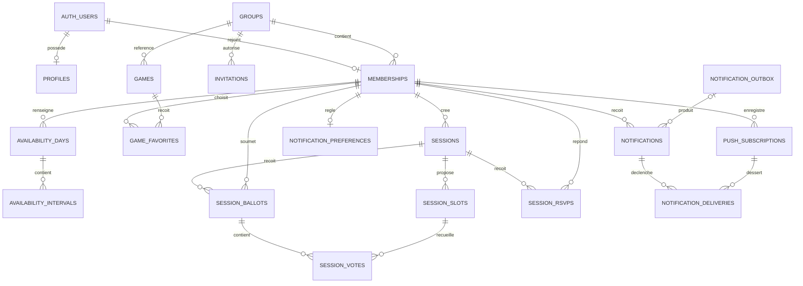
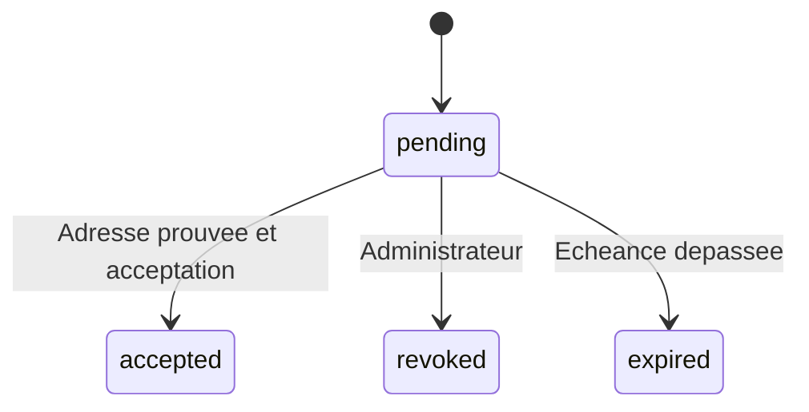
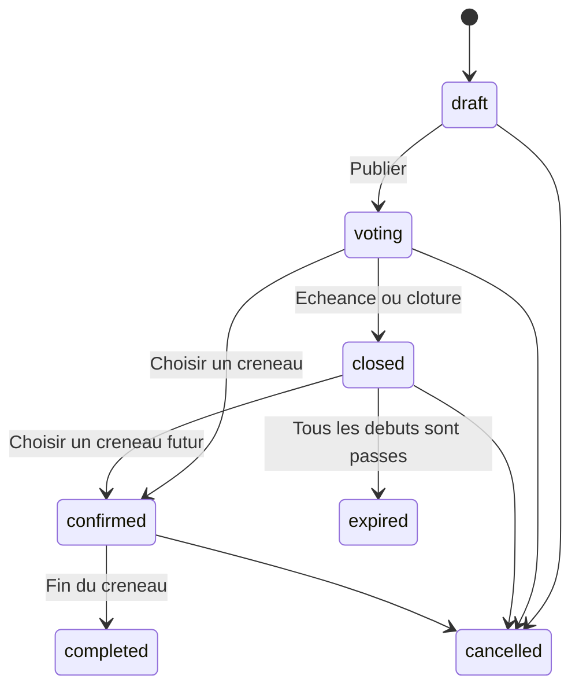
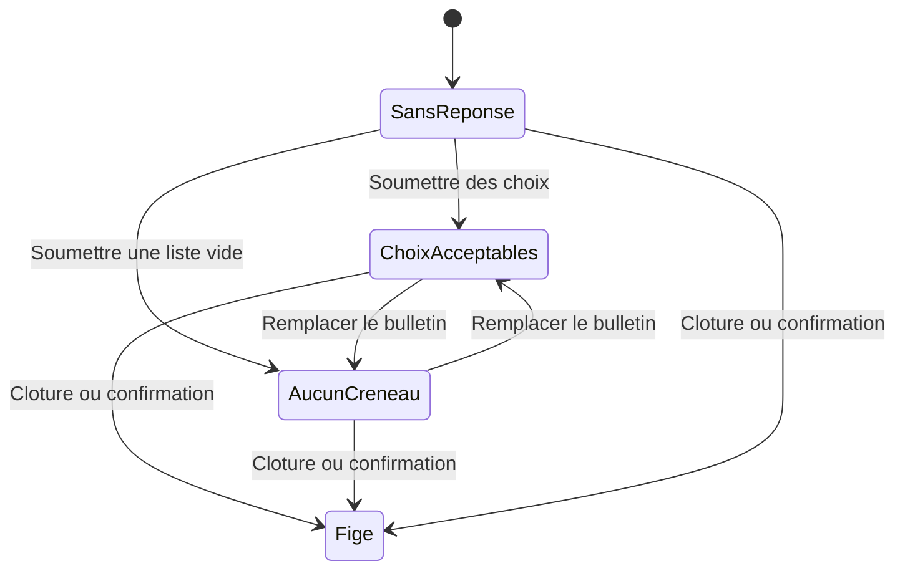
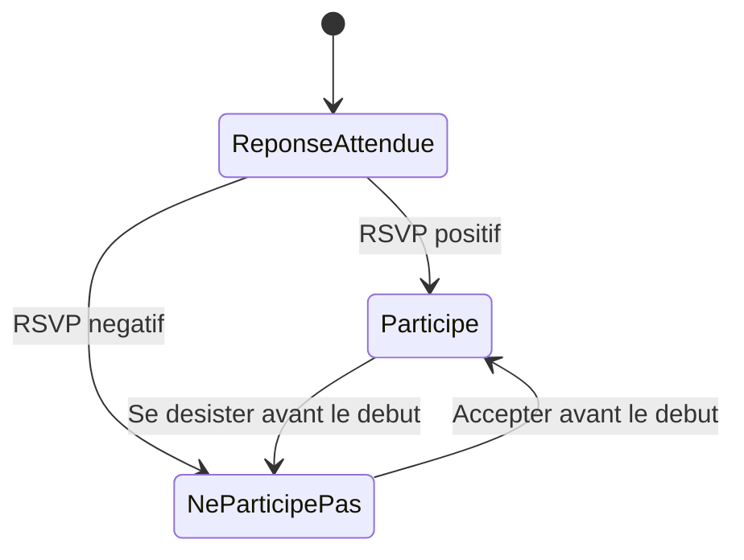

# Données, états et sécurité — OnJoueQuand

Statut : modèle logique approuvé en J0, à traduire en migrations versionnées. Ce document ne constitue pas une migration exécutée. Références : [PRD](product-requirements.md), [architecture](architecture.md), [roadmap](roadmap.md).

## Conventions et relations

Identifiants UUID, instants `timestamptz`, dates civiles `date`, révisions entières positives, horodatages de création/modification générés par la base. Les chaînes d'état sont des valeurs techniques anglaises traduites dans l'interface. Les mutations à révision vérifient la valeur attendue sous verrou et incrémentent une seule fois par opération.

Les données métier exposables sont dans le schéma applicatif exposé avec RLS. Outbox, livraisons, audit technique, compteurs de fréquence et suivi des jobs sont dans un schéma privé non exposé. Les identifiants Auth proviennent de `auth.users` ; aucune copie d'OTP ni de mot de passe n'est stockée.

Les tables enfants portent les identifiants de parent nécessaires à des clés étrangères composites. Ne pas compter sur un UUID difficile à deviner ni sur le filtre `group_id` de l'UI pour assurer la cohérence.

Un compte provisionné peut ne pas encore avoir de profil ni d'adhésion. Un brouillon peut n'avoir aucun créneau ; la publication impose deux à six créneaux. Ces cardinalités expliquent les relations optionnelles du diagramme.

## Dictionnaire des entités

Les colonnes ci-dessous définissent le minimum logique. Les migrations préciseront noms de contraintes, index et types générés sans changer ces invariants.

### Groupe et identité

| Table | Colonnes métier essentielles | Contraintes et relations |
| --- | --- | --- |
| `groups` | `id`, `singleton`, `name`, `timezone`, `quick_start`, `quick_end`, `revision` | `singleton = true` et unique : au plus un groupe ; bootstrap en crée un. Fuseau Europe/Paris au MVP. Plage rapide initiale 20:00–23:00, dans une journée et alignée sur quinze minutes. |
| `profiles` | `user_id`, `display_name` | PK/FK vers Auth ; nom non vide. Initiales dérivées. Ni e-mail partagé, ni rôle provenant du profil. |
| `memberships` | `id`, `group_id`, `user_id`, `role`, `status`, `joined_at`, `revoked_at`, `revision` | Utilisateur unique dans cette installation ; rôle `admin/member`, état `active/revoked`. Unicité `(group_id, id)` pour les références composites. Identifiant stable pour l'historique. |
| `invitations` | `id`, `group_id`, `normalized_email`, `invited_by`, `auth_user_id` nullable, `status`, `expires_at`, `accepted_at`, `provisioning_status`, `delivery_status`, `idempotency_key`, `revision` | Une invitation `pending` par groupe/adresse ; transitions sous verrou. `auth_user_id` n'est pas une preuve d'adresse vérifiée. États de provisionnement/envoi indépendants de l'acceptation. |

Une invitation expirée est clôturée transactionnellement avant d'en créer une nouvelle. Ne pas écrire un index partiel dépendant de `now()` : l'index porte sur le statut, et la commande contrôle l'échéance. Un compte Auth existant est réutilisé après vérification ; une panne d'envoi laisse une invitation réessayable.

L'adresse d'invitation normalisée utilise une règle commune cohérente avec Auth, sans suppression de points ni de suffixes `+`. Le profil ne donne pas accès à l'adresse d'autrui.

### Disponibilités et jeux

| Table | Colonnes métier essentielles | Contraintes et relations |
| --- | --- | --- |
| `availability_days` | `id`, `group_id`, `membership_id`, `local_date`, `status`, `mode`, `revision` | Unique `(membership_id, local_date)` ; `unanswered/unavailable/available` ; `quick/detailed` seulement si disponible. |
| `availability_intervals` | `id`, `group_id`, `membership_id`, `day_id`, `starts_at`, `ends_at` | Parent cohérent par FK composite ; début < fin ; intervalle inclus dans la journée locale du parent, fin au minuit suivant autorisée. |
| `games` | `id`, `group_id`, `name`, `description` facultative, `created_by`, `archived_at`, `revision` | Nom non vide ; appartient au groupe. Archivage plutôt que suppression s'il est référencé par une session. |
| `game_favorites` | `group_id`, `membership_id`, `game_id` | PK membre/jeu ; FK des deux côtés dans le même groupe. |

Une contrainte d'exclusion GiST sur le membre et `tstzrange(starts_at, ends_at, '[)')` empêche les chevauchements persistés. Utiliser l'extension PostgreSQL adaptée (`btree_gist`) via migration. Un trigger de contrainte différé vérifie l'accord état/intervalles à la fin de la transaction : disponible implique au moins un intervalle ; les deux autres états impliquent zéro intervalle. Une contrainte `CHECK` seule ne peut pas compter des lignes enfants.

### Sessions et participation

| Table | Colonnes métier essentielles | Contraintes et relations |
| --- | --- | --- |
| `sessions` | `id`, `group_id`, `created_by`, `title`, `description`, `game_id` nullable, `status`, `vote_deadline`, `minimum_players`, `confirmed_slot_id` nullable, `published_at`, `revision` | Seuil initial 2 ; FK jeu du groupe. Créneau confirmé lié à cette session par FK composite. |
| `session_slots` | `id`, `group_id`, `session_id`, `starts_at`, `ends_at` | Début < fin ; paire d'instants unique par proposition. Deux à six candidats valides au moment de publier. |
| `session_ballots` | `id`, `group_id`, `session_id`, `membership_id`, `submitted_at`, `revision` | Unique session/membre. Existe même lorsque la sélection est vide. |
| `session_votes` | `group_id`, `session_id`, `ballot_id`, `slot_id` | Unique bulletin/créneau ; FK composites garantissant même session et groupe pour bulletin et créneau. |
| `session_rsvps` | `group_id`, `session_id`, `membership_id`, `response`, `revision`, `updated_at` | Unique session/membre ; `attending/declined`. Pas de ligne = réponse attendue. |

La FK du créneau confirmé est ajoutée après la création des deux tables pour résoudre la référence circulaire. Les contraintes/guards imposent un créneau pour `confirmed/completed` ; un créneau peut être conservé pour une session annulée après confirmation. Un statut ne peut pas être modifié directement pour contourner les transitions.

Les candidats peuvent se chevaucher entre eux : ce sont des alternatives. Les engagements RSVP, eux, ne peuvent pas se chevaucher pour un même membre. Le contrôle intersessions exige la transaction décrite plus bas ; un `CHECK` sur `session_rsvps` ne suffit pas.

### Notifications et infrastructure

| Table | Colonnes métier essentielles | Contraintes et relations |
| --- | --- | --- |
| `notification_preferences` | `membership_id`, `reminders_enabled`, `push_enabled` | Une ligne par membre ; rappels internes activés par défaut, Push inactif tant que le membre ne l'a pas activé. |
| `notifications` | `id`, `membership_id`, `event_key`, `type`, `resource_id`, `payload`, `created_at`, `read_at` | Unique événement/destinataire ; payload interne minimal ; propriétaire seul lecteur. |
| `push_subscriptions` | `id`, `membership_id`, `endpoint`, `p256dh`, `auth`, `created_at`, `disabled_at` | Endpoint unique, clés privées aux autres membres. Inscription et transfert d'appareil contrôlés, jamais par simple revendication d'un endpoint déjà possédé. |
| `notification_outbox` | `id`, `event_key`, `type`, `resource_id`, `payload`, `available_at`, `expires_at`, `status`, `lease_until`, `lease_token`, `attempts` | Clé d'événement unique ; état `pending/processing/completed/failed/skipped`. Schéma privé. |
| `notification_deliveries` | `id`, `notification_id`, `subscription_id`, `status`, `attempts`, `next_attempt_at`, `lease_until`, `lease_token`, `last_error_code` | Unique notification/appareil ; états `pending/sending/sent/failed/skipped`. Pas de réponse fournisseur sensible brute. |
| `audit_events` | `id`, `group_id`, `actor_id`, `action`, `resource_id`, `created_at`, `metadata` restreinte | Append-only depuis les commandes autorisées ; pas de secrets ni copie intégrale de données privées. |
| `job_runs` | `id`, `started_at`, `finished_at`, `status`, compteurs et code d'erreur | Schéma privé ; heartbeat et contrôle d'exploitation. |
| `rate_limit_counters` | `key_hash`, `window_start`, `count`, `expires_at` | Schéma privé ; incrément atomique ; suppression après expiration ; aucune adresse brute. |

Les clés événementielles assurent la déduplication sans dépendre d'une ligne d'outbox conservée indéfiniment. La référence d'une notification à une outbox est facultative ; sa purge ne supprime pas une notification encore dans sa durée de conservation. Les clés de rappels portent le membre, le lundi cible et l'étape.

Prévoir les index sur les FK, les dates par membre, les sessions par état/échéance, les notifications par destinataire/date et les travaux par état/échéance. Mesurer avant d'ajouter des index de confort.

## Disponibilités et temps

La date civile et le fuseau servent à l'intention utilisateur. Les instants UTC servent à comparer et persister. Europe/Paris reste fixe au MVP : pas d'écran pour changer rétroactivement de fuseau.

| Cas | Règle |
| --- | --- |
| Journée absente | Lecture comme `unanswered`, révision attendue nulle à la création. |
| Remise à zéro | Conserver/écrire `unanswered`, vider les intervalles et incrémenter la révision. |
| Mode rapide | Matérialiser les bornes du réglage actuel dans des intervalles ; ne pas recalculer les anciennes lignes à la lecture. |
| Mode détaillé | Remplacer les intervalles de la journée atomiquement ; normaliser l'union. |
| Traversée de minuit | Découper selon les minuits locaux réels ; vérifier les deux journées, leurs révisions et l'accord sur le remplacement. |
| Copie | Recalculer chaque horaire local dans la date cible ; préserver l'intention horaire, pas l'offset UTC. |
| Heure inexistante | Refuser la valeur avec explication ; aucune normalisation silencieuse vers une autre heure. |
| Heure répétée | Exiger première/seconde occurrence ; conserver l'instant désambiguïsé. |

Exemples de recette : le 29 mars 2026 à 02:30 à Paris est inexistant ; le 25 octobre 2026 à 02:30 possède deux occurrences. Une disponibilité 20 h–23 h copiée à travers un changement d'heure conserve ces horaires affichés, avec des instants UTC différents. Une plage se terminant exactement au début d'une autre ne les fait pas se chevaucher.

L'application utilise l'adaptateur Temporal ; les contraintes SQL contrôlent aussi le rattachement civil et l'absence de chevauchement. Les tests valident que les deux côtés utilisent des données de fuseau cohérentes. Les instants d'échéance sont comparés à l'heure de la base au moment de l'opération, et non à l'heure annoncée par le navigateur.

## Machines à états

### Invitation

Une nouvelle invitation est une nouvelle ligne après clôture de l'ancienne. `accepted`, `revoked` et `expired` sont terminaux. La validité effective inclut toujours `expires_at > heure_base`, même avant la mise à jour du statut. `provisioning_status` et `delivery_status` gèrent la reprise des systèmes externes sans faire passer l'invitation à acceptée.

### Proposition et session

| Transition | Acteur | Garde et effet |
| --- | --- | --- |
| `draft → voting` | Créateur actif ou admin | Titre, deux à six candidats futurs, échéance future ≤ premier début ; verrouiller et rendre candidats/jeu/échéance immuables ; outbox publication. |
| `voting → closed` | Créateur/admin ou job à échéance | Clôture explicite ou heure base ≥ échéance ; outbox de clôture destinée à l'organisateur. |
| `voting/closed → confirmed` | Créateur actif ou admin | Révision correcte, candidat de la proposition dont le début est futur ; choix unique, outbox confirmation. Pas de quorum bloquant. |
| `closed → expired` | Job | Tous les débuts sont ≤ heure base ; aucune confirmation possible. |
| `confirmed → completed` | Job | Fin du créneau ≤ heure base ; pas d'attestation de présence. |
| État non terminal `→ cancelled` | Créateur actif ou admin | Outbox uniquement si proposition publiée ; une session dont la fin est déjà passée est effectivement terminée et n'est plus annulable. |

Les commandes résolvent les états temporels dus sous verrou avant d'évaluer la transition. Si le job a du retard, une session `voting` au-delà de l'échéance n'accepte plus de votes ; elle peut encore être confirmée sur un candidat futur selon les règles de l'état clos. Si tous les candidats sont passés, elle est expirée. Le rattrapage n'émet pas un rappel de vote obsolète après confirmation ou expiration.

Les états terminaux `completed/cancelled/expired` ne sont pas rouverts. La session annulée conserve ses votes et RSVP comme historique mais ne bloque plus le matching ou les engagements.

### Bulletin et RSVP

Le gel n'efface pas l'état d'origine : les lignes du bulletin et leurs choix restent inchangés. Un bulletin soumis peut être remplacé, pas supprimé pour redevenir artificiellement « sans réponse ».

Après le début, le RSVP est figé. L'annulation de la session rend les réponses historiques, sans les convertir en refus. La révocation d'un membre le retire des participants actifs et des conflits calculés sans réécrire ses réponses historiques.

## Transactions et concurrence

| Opération | Garantie transactionnelle |
| --- | --- |
| Accepter une invitation | Verrouiller invitation et adhésion existante ; vérifier Auth et expiration ; créer profil/adhésion et consommer l'invitation ensemble. Une seconde acceptation du même acteur retourne le résultat déjà acquis. |
| Révoquer/changer un rôle | Verrouiller le groupe puis l'adhésion ; ne jamais retirer le dernier admin ; journaliser et désactiver abonnements/livraisons du membre. |
| Enregistrer des journées | Verrouiller les journées existantes dans l'ordre date/id ; vérifier toutes les révisions ; remplacer état et enfants ensemble. Les créations concurrentes sont arbitrées par l'unicité membre/date. |
| Copier une semaine | Recharger source et cible sous verrou ordonné ; comparer les révisions de l'aperçu, recalculer les effets ; tout appliquer ou rien. |
| Publier/remplacer un bulletin/confirmer | Verrouiller la session commune avant toute mutation ; vérifier état et heure base après obtention du verrou. Le bulletin a sa propre révision. |
| Enregistrer un RSVP | Verrouiller la session puis l'adhésion ; recontrôler début, activité et engagements existants avant insertion/mise à jour. Deux RSVP concurrents à des sessions différentes partagent le verrou d'adhésion. |
| Annuler une session | Verrouiller la session ; changer état, audit et outbox ensemble. Les engagements deviennent non bloquants par l'état de la session. |
| Réserver une livraison | Réservation `SKIP LOCKED`, bail/token ; réseau hors transaction ; acquittement conditionné au token de bail courant. |

Les chemins d'écriture sensibles sont des RPC étroites, authentifiées par le JWT de l'appelant. Les tables ne reçoivent pas de droits DML permettant de modifier directement leurs états ou colonnes protégées. Les fonctions `SECURITY DEFINER` nécessaires à ces commandes reproduisent explicitement les contrôles de membre actif, propriétaire, rôle, parent et état ; elles ne considèrent pas que RLS s'applique automatiquement au propriétaire de la fonction. Préférer `SECURITY INVOKER` lorsque les grants/RLS et invariants le permettent.

Les RPC de confirmation et de RSVP doivent utiliser un ordre de verrouillage documenté et identique. Pour une opération multi-membres, ordonner les identifiants. Ne pas étendre une opération de révocation à des verrous de session dans l'ordre inverse. Réessayer les conflits transactionnels réessayables avec borne ; un conflit de révision métier retourne une demande de rechargement, pas une réécriture silencieuse.

Une exclusion d'engagement dérivée uniquement d'une lecture préalable n'est pas sûre. Tous les chemins créant/modifiant un RSVP positif doivent passer par le même verrou d'adhésion. Un administrateur n'est pas autorisé à écrire le RSVP d'autrui. Les gardes s'exécutent même par RPC appelée directement depuis un client hostile.

## Matrice RLS et droits

Toutes les tables exposées ont RLS activée. Aucun `anon` n'a de droit sur les données privées. Un utilisateur Auth sans adhésion active n'a pas de lecture métier, sauf via la RPC étroite d'acceptation d'invitation. Une clé serveur ne sert jamais à rendre les lectures ordinaires « plus simples ».

| Ressource | Lecture | Écriture/commande |
| --- | --- | --- |
| Groupe | Membres actifs | Admin via commande validée ; pas de second groupe créé depuis l'application. |
| Profils et annuaire | Membres actifs, champs non sensibles | Profil personnel ; rôle/statut exclus des champs modifiables. |
| Adhésions | Membres actifs pour l'annuaire | Admin par RPC ; identité, rôle et dernier admin protégés. |
| Invitations | Admins | Admin pour création/révocation ; acceptation par identité Auth vérifiée via RPC. Aucune liste d'adresses exposée au non-membre. |
| Journées/intervalles | Membres actifs du groupe | Propriétaire actif via commande transactionnelle ; admin ne modifie pas autrui. |
| Jeux | Membres actifs | Création par membre ; modification/archivage par créateur actif ou admin. |
| Favoris | Membres actifs du groupe | Propriétaire ; unicité membre/jeu. |
| Sessions/créneaux | Brouillon : créateur/admin ; publié : membres actifs | Créateur/admin selon état ; candidats immuables après publication. |
| Bulletins/votes | Membres actifs pour sessions publiées | Propriétaire pendant vote effectif uniquement ; créneaux du bon parent. |
| RSVP | Membres actifs pour sessions publiées | Propriétaire actif jusqu'au début, avec contrôle de conflit. |
| Préférences/notifications | Propriétaire actif | Préférences personnelles ; notification créée par job, seul `read_at` modifiable par propriétaire. |
| Abonnements Push | Propriétaire actif | Propriétaire via validation ; pas de transfert à partir d'un identifiant fourni sans preuve de possession. |
| Outbox/livraisons/compteurs/jobs | Aucun accès direct client | Backend dédié ; métriques réduites exposées aux admins par voie contrôlée. |
| Audit | Admin via lecture restreinte | Append-only depuis commandes ; aucune écriture directe cliente. |

Les aides de politique telles que « membre actif du groupe » ne doivent pas déclencher une récursion RLS sur `memberships`. Utiliser une fonction d'aide étroite dans un schéma privé, identité provenant de `auth.uid()`, `search_path` fixé, corps sans SQL dynamique et droits minimaux. Vérifier ce cas sur la vraie base.

Retirer les grants `PUBLIC` sur les fonctions privilégiées et accorder uniquement les rôles nécessaires. Les rôles `authenticated` ordinaires n'exécutent pas les fonctions de job ou de provisionnement. Les policies `USING` et `WITH CHECK`, les grants de colonnes et les guards de RPC doivent empêcher le déplacement d'une ligne vers un autre propriétaire/groupe.

Tester aussi les FK et clés hors groupe avec un jeu de fixture isolé : le singleton de production ne doit pas devenir une excuse pour ignorer les relations incohérentes ou les références à une autre proposition.

## Conservation et suppression

- **Disponibilités** : conserver les douze semaines complètes précédant la semaine courante et les semaines courante/futures ; purger les journées plus anciennes avec leurs intervalles. La copie respecte cette fenêtre.
- **Sessions** : conserver douze mois après fin, annulation ou expiration, avec créneaux, bulletins et RSVP. Les brouillons abandonnés sont purgés douze mois après leur dernière modification. Aucune purge de session future active.
- **Notifications et audit** : quatre-vingt-dix jours après création ; supprimer leurs livraisons associées à expiration. Les jobs terminés et outbox terminées suivent au plus cette durée ; ne pas purger un travail encore vivant sans le marquer expiré/échoué.
- **Invitations** : supprimer les invitations terminales après quatre-vingt-dix jours ; une invitation échue est terminalisée avant purge. Aucun lien historique essentiel ne dépend de leur conservation éternelle.
- **Abonnements** : désactiver immédiatement sur révocation, refus explicite ou réponse permanente du fournisseur ; supprimer les clés devenues inutiles. Les compteurs de fréquence expirent selon leur fenêtre.
- **Profils, adhésions et jeux** : conserver les identifiants nécessaires aux relations encore retenues ; archiver/révoquer plutôt que casser l'historique. Une demande de suppression de compte relève d'une procédure d'exploitation contrôlée : supprimer les secrets et données personnelles, anonymiser les références nécessaires, puis traiter Auth avec les dépendances vérifiées. Pas de cascade incontrôlée depuis Auth vers les sessions du groupe.
- **Sauvegardes** : durée de vie indépendante de sept jours ; une suppression applicative se propage par expiration des sauvegardes. Aucune rétention implicite illimitée via des exports manuels.

Les liens de notifications vers une ressource purgée restent ouvrables vers une explication française « Cette session n'est plus disponible », sans erreur brute. Les agrégats futurs de J9 doivent respecter la période retenue et documenter comment sont traitées les révocations/réactivations ; ne pas déduire un historique d'adhésion inexistant à partir d'un statut courant.

## Migrations et données de test

Créer les extensions, tables, contraintes, fonctions, policies et grants par migrations reproductibles. Les paramètres secrets et le bootstrap réel restent hors migrations. Vérifier à chaque changement l'application depuis une base vide et depuis le schéma précédent, puis régénérer les types Supabase.

Seeds synthétiques : deux administrateurs, plusieurs membres, un utilisateur Auth non membre et un membre révoqué ; disponibilités complètes/incomplètes, scénarios DST, jeux archivés, propositions dans différents états et bulletins vides. Aucun e-mail de personne réelle.

Les tests d'intégration couvrent les appels autorisés et refusés avec leurs vrais JWT et des transactions concurrentes distinctes. Les contrôles RLS ne sont jamais exécutés uniquement sous `service_role`. Les tables différées de sondage ne sont pas créées au MVP.
