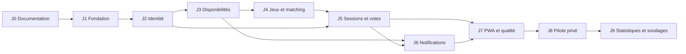

# Feuille de route — OnJoueQuand

## État et ordre de livraison

Le plan est approuvé. **J0 à J6 sont commités et poussés ; J6 porte le commit `19b6ce2` et sa CI distante a réussi. J7 est réalisé localement et reste non commité ; [rapport J7](j7-validation.md). J8–J9 ne sont pas implémentés.** « Push et continue » autorise J7 ; le caractère public du dépôt GitHub a été confirmé avant publication. Aucun déploiement ni migration de production. Cron inactif ; installation/Push réels restent des portes de lancement.

Les critères ci-dessous sont des portes de sortie : un jalon n'est livré que lorsque ses critères et tests sont vérifiés. Les résultats réels, versions, environnements et limites seront consignés au fur et à mesure. Aucune estimation calendaire ne vaut engagement.

Les interfaces d'engagements occupés sont définies en J4 et exercées avec des fixtures ; leur branchement sur les RSVP réels est livré en J5. Cette séquence évite une dépendance circulaire entre matching et sessions. Le MVP n'est complet qu'après J8.

## Jalons détaillés

### J0 — Documentation

**Dépendances :** plan approuvé et mode autorisant l'édition ; satisfaits pour cette livraison.

**Livrables :** README, consignes AGENTS, PRD identifié, architecture, modèle relationnel et machines à états, cette roadmap, index et neuf ADR acceptées.

**Acceptation :** les quinze sujets demandés sont couverts ; le statut réel est explicite ; exigences, permissions, paramètres et états sont cohérents ; aucun code applicatif, migration exécutable ou workflow ajouté.

**Vérifications :** existence et contenu des documents, résolution des liens Markdown internes et ancres, correspondance PR/J/T/ADR, clôture des blocs de code, `git diff --check`, contrôle de la liste des fichiers modifiés. Aucun test applicatif n'est revendiqué.

### J1 — Fondation

**État :** socle réalisé et vérifié sous Windows et Linux, y compris le focus clavier WebKit ; preuves et limites dans le [rapport de validation](j1-validation.md). La CI distante a ensuite réussi au commit J6 ; J7 reste vérifié localement.

**Dépendances :** J0 et demande distincte d'implémenter le socle.

**Livrables :** Next.js App Router et npm verrouillés, TypeScript strict, Tailwind/shadcn, shell des quatre onglets, configuration d'environnement validée, Supabase local, outils Vitest/Playwright, CI initiale et commandes documentées.

**Acceptation :** versions stables compatibles consignées, aucun paquet canary requis ; installation reproductible depuis un clone propre ; navigation française responsive avec thème sombre ; exemple d'environnement sans secret ; build et pipeline verts. Les écrans non implémentés n'affichent pas de fausses données de production.

**Tests :** T-UI initial, installation propre, lint, typage et build explicites, test smoke des quatre routes, validation des variables manquantes. Vérifier le runtime local/CI/Vercel et documenter les versions exactes. La CI est complétée par les suites réelles aux jalons suivants.

### J2 — Identité et groupe privé

**État :** implémenté localement ; migration, Auth, RLS et parcours vérifiés dans le [rapport J2](j2-validation.md). Le premier code et le transport d'invitation précisent le plan via [ADR 010](decisions/010-premier-code-et-invitation-smtp.md). SMTP de production et exécution GitHub distante restent à valider avant lancement.

**Dépendances :** J1 ; configuration Auth et boîte SMTP locale. Un SMTP de production n'est nécessaire qu'avant les essais réels hors environnement local.

**Livrables :** migrations groupe/profils/adhésions/invitations, OTP, bootstrap administrateur, acceptation, profil, révocation, protections de rôle et RLS. État de provisionnement/envoi réessayable et limitation durable des demandes.

**Acceptation :** un invité peut se connecter et rejoindre le groupe ; un compte Auth non membre ne lit aucune donnée ; un membre révoqué perd l'accès malgré un JWT valide ; le dernier administrateur ne peut être retiré. Aucun provisionnement ne confirme artificiellement une adresse. Les erreurs n'énumèrent pas les comptes.

**Tests :** T-AUTH et T-RLS ; invitations expirées, révoquées, déjà acceptées ou adresse différente ; OTP invalide/expiré/réutilisé ; création publique désactivée ; compte préexistant ; acceptation concurrente ; timeout après création Auth ; SMTP en échec ; attaques directes sur tables et RPC. Prouver le parcours compte non confirmé + `shouldCreateUser: false` avec les versions retenues.

### J3 — Disponibilités et calendrier

**État :** réalisé localement ; règles temporelles, transactions/RLS et parcours documentés dans le [rapport J3](j3-validation.md). L'implémentation est précisée par [ADR 011](decisions/011-disponibilites-et-apercus.md).

**Dépendances :** J2 ; adaptateur temporel commun.

**Livrables :** journées et intervalles, saisie rapide/détaillée, calendrier partagé, complétude, aperçu/application de copie, révisions et horizon de quatre semaines.

**Acceptation :** les trois états restent distincts ; 20 h–23 h est visible et matérialisé ; mode détaillé et copie ne produisent aucun chevauchement invalide ; aucun écrasement silencieux ; sept réponses explicites rendent la semaine complète. La saisie et la copie traversant minuit sont atomiques.

**Tests :** T-AVAIL, T-COPY, T-TIME et T-RLS ; jeux de données à quinze membres ; échec sur une journée d'une transaction multi-journées ; borne de semaine et d'horizon ; modifications source/cible après aperçu ; création concurrente d'une journée absente ; fuseau serveur différent de Paris.

### J4 — Catalogue et matching

**État :** réalisé localement : catalogue, favoris, suggestions expliquées et filtres ; [preuves J4](j4-validation.md). Le calcul soustrait les engagements fournis par contrat ; l’adaptateur des RSVP persistés est branché en J5.

**Dépendances :** J3 ; contrat de lecture des engagements occupés défini, fixtures disponibles avant J5.

**Livrables :** création/modification/archivage de jeux, favoris, fonction pure de recherche, filtres et explication des dix meilleurs candidats. Pas de cache ni service de calcul externe.

**Acceptation :** deux joueurs et soixante minutes par défaut ; sélection et durée ajustables ; chaque membre proposé couvre toute la durée ; aucune absence de réponse interprétée comme disponibilité ; classement déterministe. Un jeu archivé conserve son historique.

**Tests :** T-GAMES et T-MATCH ; comparaison sur petits cas avec un oracle simple d'intersection ; disponibilités disjointes, trous, membres changeant à une borne, intervalles contigus, égalités de classement, seuil impossible et aucune suggestion. Benchmark cible : p95 du calcul < 100 ms après échauffement pour quinze membres/quatre semaines, fixture et machine documentées. La soustraction des engagements est testée avec fixtures puis intégrée en J5.

### J5 — Propositions, votes et RSVP

**État :** réalisé localement ; [rapport J5](j5-validation.md), [ADR 012](decisions/012-sessions-transactions-et-retour-membre.md). Échéances SQL, confirmations atomiques, RSVP concurrents, historique, accueil et raccordement au matching vérifiés. L’outbox est persistée ; sa consommation et le cron restent en J6.

**Dépendances :** J2 et J4.

**Livrables :** modèles session/candidats/bulletins/votes/RSVP, machines à états, commandes transactionnelles, historique, intégration des engagements réels au matching. Les transitions écrivent déjà les événements d'outbox destinés à J6.

**Acceptation :** parcours proposition → vote multiple → choix unique → RSVP explicite ; candidats immuables après publication ; échéance effective indépendamment du cron ; aucun vote transformé en RSVP ; aucun engagement double, même sous concurrence. Créateur révoqué remplacé par les administrateurs pour la gestion. Les mutations dépassant leur révision échouent proprement.

**Tests :** T-SESSION, T-CONCURRENCY, T-RLS et T-E2E ; liste vide contre absence de bulletin ; confirmation anticipée ou après clôture ; mauvais parent de créneau ; deux confirmations ; vote arrivé après verrou de clôture ; candidat passé ; RSVP concurrents intersessions ; annulation libérant un engagement ; appel direct contournant l'UI. Vérifier le matching avec RSVP PostgreSQL réels.

### J6 — Notifications et rappels

**État :** code réalisé et vérifié localement ; [rapport J6](j6-validation.md), [ADR 013](decisions/013-notifications-et-livraison-bornee.md), [exploitation](notifications-operations.md). Centre interne, préférences, baux, rappels Paris, route et appel pg_net/Vault de recette vérifiés. Cron installé inactif. Réception Push réelle, configuration distante et CI restent à valider ; ne pas les considérer acquises.

**Dépendances :** J3 et J5 ; secret de job, VAPID et cron configurés dans un environnement de test ; envois réels limités aux appareils de recette.

**Livrables :** centre interne, préférences, abonnements, outbox/livraisons, route interne, job toutes les cinq minutes, rappels dimanche/lundi, transitions temporelles, heartbeat et retries bornés.

**Acceptation :** rappels uniquement pour la bonne semaine encore incomplète ; préférences et révocation respectées avant envoi ; aucune notification interne dupliquée ; preuve de reprise d'un job interrompu ; Push facultatif, aucune panne fournisseur ne fait échouer une confirmation métier déjà commise.

**Tests :** T-JOBS, T-NOTIFY, T-TIME et T-RLS ; exécutions doubles, jobs en retard, dimanche sauté puis lundi rattrapé sans double rappel ; bail expiré ; crash après envoi avant acquittement ; `404/410/429/5xx` ; désabonnement/révocation entre mise en file et traitement ; endpoint privé malveillant ; route sans mauvais/bon secret ; aucun secret dans les logs.

### J7 — PWA et qualité transversale

**État :** code réalisé localement, avec [ADR 014](decisions/014-pwa-cache-et-mises-a-jour.md). Manifeste/icônes, vrai worker, repli, mises à jour multi-onglets et contrôles d’accès au premier plan vérifiés dans le [rapport J7](j7-validation.md). La [recette sur appareils réels](pwa-device-checklist.md) n’est pas exécutée : elle reste une condition avant clôture complète de la porte J7 et lancement J8.

**Dépendances :** J5 et J6 ; accès à iPhone/iPad compatible, Android et navigateur de bureau de recette.

**Livrables :** manifest, icônes, service worker, installation contextuelle, écran hors connexion, parcours français et audit ciblé d'accessibilité.

**Acceptation :** installation et lancement autonome sur plateformes cibles ; permission Push sur action volontaire ; refus de permission sans blocage ; mise à jour non destructive du service worker ; aucune donnée privée dans Cache Storage ou repli hors ligne.

**Tests :** T-PWA, T-UI et T-E2E sur Chromium/Firefox/WebKit ; appareils réels pour installation/Push ; clavier, focus, contrastes, réduction d'animation, tailles mobile/tablette/bureau ; session expirée, reprise de focus, déconnexion et indisponibilité réseau pendant une saisie. Les limites propres au navigateur sont affichées sans promesse trompeuse.

### J8 — Pilote privé et exploitation

**Dépendances :** J1–J7 ; domaine/DNS, comptes production, SMTP vérifié, premier administrateur désigné, appareils de recette et conditions d'usage validées.

**Livrables :** environnements séparés, chaîne de livraison protégée, migrations compatibles, secrets, sauvegarde quotidienne chiffrée, procédure de restauration, runbook d'incident, surveillance et groupe pilote.

**Acceptation :** aucun défaut critique ouvert ; tests de sécurité et parcours verts ; sauvegarde récente réellement restaurée dans un projet isolé ; alertes adressées au mainteneur désigné ; rollback applicatif démontré ; aucune preview non fiable n'accède à la production. Les invitations réelles ne sont envoyées que dans le cadre du lancement autorisé.

**Tests :** T-OPS, T-E2E, T-RLS ; smoke tests après déploiement ; simulation fournisseur e-mail indisponible et worker arrêté ; restauration Auth/relations/droits ; secrets/réglages externes récupérables ; contrôle de quota et âge de sauvegarde. Mesurer saisie d'une semaine < deux minutes et parcours de décision sans assistance avec les utilisateurs pilotes, sans instrumentation tierce obligatoire.

### J9 — Statistiques et sondages, après MVP

**Dépendances :** J8, retours du pilote et validation distincte du périmètre J9.

**Livrables :** indicateurs dérivés, définitions affichées, sondages simples/multiples et leurs migrations propres.

**Acceptation :** chiffres explicables sur une période affichée ; aucun RSVP présenté comme preuve de présence ; traitement explicite des membres révoqués/réactivés et de la conservation. Question/choix/mode deviennent immuables après ouverture d'un sondage ; règles détaillées de résultat et de visibilité finalisées avant développement J9.

**Tests :** T-STATS et T-POLLS ; annulations, sessions passées, changement de rôle, périodes partielles, suppression de données anciennes, options invalides, vote simple/multiple, clôture et concurrence. Les tables et écrans J9 ne sont pas livrés anticipativement dans le MVP.

## Catalogue des tests

| Suite | Niveau principal | Scénarios et résultat attendu |
| --- | --- | --- |
| T-AUTH | Intégration Auth + Playwright | Preuve d'adresse, OTP et invitation indépendante ; pas d'accès avec compte non invité ; reprise sans doublon. |
| T-RLS | SQL/Supabase avec JWT de test | Anonyme, Auth sans adhésion, membre A/B, admin, révoqué ; SELECT/INSERT/UPDATE/DELETE et RPC directes ; données/colonnes interdites inaccessibles. |
| T-AVAIL | Vitest + SQL + parcours | États, intervalles, normalisation, horizon, complétude et visibilité ; un état indisponible ou sans réponse n'a aucun intervalle. |
| T-COPY | Vitest + intégration | Remplissage vs remplacement, aperçu périmé, source vide, application atomique et préservation des heures locales. |
| T-TIME | Vitest + SQL | Paris 29 mars/25 octobre 2026, heures inexistantes/répétées, minuit, année ISO, copie et rappels ; ne dépend pas du fuseau hôte. |
| T-GAMES | Intégration + parcours | Jeu personnalisé, droits créateur/admin, favori unique, archivage sans rupture des sessions historiques. |
| T-MATCH | Vitest + benchmark | Intersection d'identités sur toute la durée, engagements soustraits, tri stable, oracle de référence et performance documentée. |
| T-SESSION | Vitest + SQL + parcours | États/acteurs/échéances, bulletin vide vs absent, choix multiple, confirmation et RSVP distincts, ressources étrangères refusées. |
| T-CONCURRENCY | Connexions SQL distinctes | Double acceptation, copies/éditions, vote/clôture, confirmation concurrente et RSVP intersessions ; aucun invariant violé. |
| T-JOBS | Intégration avec horloge contrôlée | Retard/reprise/doublon/bail, même semaine dimanche/lundi, rattrapage borné, job non autorisé refusé. |
| T-NOTIFY | Intégration + appareils | Unicité interne, Push best-effort, erreurs fournisseur, préférences et révocation ; payload minimal sans fuite. |
| T-PWA | Playwright + appareils réels | Manifest, installation, permission, clic sécurisé, hors connexion, changement de worker et absence de cache privé. |
| T-UI | Playwright + revue ciblée | Quatre onglets, français, responsive, clavier, focus/contraste, états lisibles sans couleur seule. |
| T-E2E | Playwright multi-comptes | Inviter → renseigner/copier → proposer → voter → confirmer → RSVP ; erreurs et reprises de session. |
| T-OPS | Environnement isolé | Clone propre, migrations, build, déploiement, rollback, restauration, heartbeat et alertes. |
| T-STATS | Vitest + SQL, différé | Métriques sur période retenue, annulations, adhésions et RSVP sans prétendre observer la présence. |
| T-POLLS | SQL + parcours, différé | Modes simple/multiple, droits, options du bon sondage, échéance et remplacement atomique du bulletin. |

La CI lance les tests pertinents disponibles à chaque jalon. Les tests RLS n'utilisent pas une clé qui contourne les politiques pour simuler les lecteurs ; les tests concurrents n'utilisent pas seulement des promesses sur une même connexion.

## Couverture des livrables demandés

| Sujet demandé | Référence principale |
| --- | --- |
| 1. Exigences produit | [PRD](product-requirements.md) |
| 2. MVP et fonctions différées | [Périmètre](product-requirements.md#perimetre-de-livraison) |
| 3. Architecture et décisions | [Architecture](architecture.md), [ADR](decisions/README.md) |
| 4. Arborescence | [Structure cible](architecture.md#structure-cible-et-frontieres) |
| 5. Relations de données | [Modèle relationnel](database.md#conventions-et-relations) |
| 6. Authentification et invitations | [Flux Auth](architecture.md#authentification-et-invitations) |
| 7. Disponibilités | [Modèle temporel](database.md#disponibilites-et-temps) |
| 8. Matching | [Algorithme](architecture.md#modele-temporel-et-matching) |
| 9. États sessions/votes | [Machines à états](database.md#machines-a-etats) |
| 10. Notifications et scheduling | [Worker et cron](architecture.md#notifications-et-traitement-planifie) |
| 11. Installation PWA | [PWA](architecture.md#pwa-installation-et-cache) |
| 12. Sécurité et RLS | [Matrice](database.md#matrice-rls-et-droits) |
| 13. Tests | [Catalogue](#catalogue-des-tests), [stratégie](architecture.md#strategie-de-tests) |
| 14. Déploiement | [Exploitation](architecture.md#deploiement-couts-et-exploitation) |
| 15. Jalons | [Jalons détaillés](#jalons-detailles) |

## Conditions de lancement et points bloquants

| Point | Responsable attendu | Échéance | Preuve de sortie |
| --- | --- | --- | --- |
| Approbation du cadrage documentaire | Porteur du produit | J0 | Acquise dans la demande d'implémenter ce plan ; ne pas la présenter comme encore bloquante. |
| Début des fonctionnalités | Porteur du produit | Avant J1 | J1 autorisé par « commit et go pour j1 ». J2 reste une étape distincte. |
| Versions et compatibilité | Implémenteur | J1 | Matrice exacte, lockfile et pipeline vert. |
| Parcours OTP avec comptes provisionnés | Implémenteur | J2 | Test réel local de la configuration Auth retenue, dont compte non confirmé et création publique désactivée. |
| Domaine d'envoi et DNS | Exploitant | Avant e-mails réels/J8 | Domaine vérifié, SMTP et invitation livrés aux adresses de recette. |
| Comptes Vercel, Supabase, Resend | Exploitant | J8 | Propriétaires identifiés, régions choisies, secrets par environnement, accès de maintenance. |
| Éligibilité à Hobby | Porteur/exploitant | J8 | Usage personnel non commercial confirmé ; sinon offre adaptée avant publication. |
| Premier administrateur | Porteur du groupe | J8 | Adresse désignée et bootstrap/connexion OTP validés. |
| Cron, VAPID et isolation | Implémenteur/exploitant | J6 puis J8 | Appel authentifié, rotation documentée, heartbeat, Push de recette, aucun envoi de preview. |
| Sauvegarde et récupération | Exploitant | J8 | Export récent, clé de restauration accessible hors dépôt, restauration isolée réussie. |
| iOS/Android/bureau réels | Équipe de recette | J7–J8 | Checklist datée indiquant appareils, systèmes, navigateurs et résultats. |
| Exploitation gratuite acceptée | Porteur/exploitant | J8 | Limites de pause/quota et absence de SLA comprises, contact d'incident défini. |

Les décisions produit du MVP sont arrêtées. Les éléments ci-dessus sont des validations techniques et prérequis d'exploitation, pas une raison de bloquer la documentation ou de réclamer des secrets dans le chat. Aucun achat, création de compte externe ou invitation réelle n'a été effectué en J0.

## Critères de fin du MVP

PR-01 à PR-16 livrées et vérifiées ; aucun défaut critique de sécurité, de données ou de parcours ; restauration prouvée ; installation et Push vérifiés sur les plateformes cibles ; un groupe pilote peut coordonner une session sans assistance. Les limites de Push, de coût et d'hébergement sont documentées, et le statut des fonctions différées reste explicite.
